# 周五 11 月 13 日｜范数、级数、Kronecker 和微积分

**今天 205 分钟。** 范数和级数 50 分钟，Kronecker 25 分钟，微积分 45 分钟，混合题和短证明 65 分钟，订正 20 分钟。只有 90 分钟时，做跟做 1、3 和混合 F1、F2、F4、F5，最后抄下最容易混的两条条件。

## 讲义与跟做

### 跟做 1　2024 青岛 II.7 为什么先判收敛再求逆

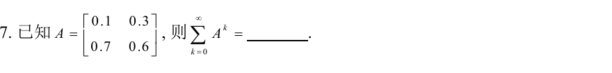

1. **看到 \(\sum_{k=0}^\infty A^k\)，先确认可以收敛。** 矩阵的诱导 1 范数取最大绝对列和。第一列的和是 \(0.1+0.7=0.8\)，第二列是 \(0.3+0.6=0.9\)，故 \(\|A\|_1=0.9<1\)。这样就可以判收敛。用行和得到 \(1.3\) 只能说明这次没法用「行和小于 1」来判。
2. **说明为什么出现 \(I-A\)。** 写有限和 \(S_n=I+A+\cdots+A^n\)。左乘 \(I-A\) 后中间项抵消，\((I-A)S_n=I-A^{n+1}\)。当 \(A^{n+1}\to0\) 时，和是 \((I-A)^{-1}\)。
3. **把逆矩阵算出来。** \(I-A=\begin{bmatrix}0.9&-0.3\\-0.7&0.4\end{bmatrix}\)，行列式 \(0.9\cdot0.4-0.3\cdot0.7=0.15\)。交换对角、把另两项变号，再除以行列式，得到
   \[
   \sum_{k=0}^\infty A^k
   =\frac1{0.15}\begin{bmatrix}0.4&0.3\\0.7&0.9\end{bmatrix}.
   \]
4. **辨认同类题。** \(\rho(A)=\max_\lambda|\lambda|\)。\(A^k\to0\) 及几何级数收敛都等价于 \(\rho(A)<1\)。某个相应矩阵范数小于 1 是好用的充分条件。例 \(\operatorname{diag}(1,1/2)^k\to\operatorname{diag}(1,0)\)，幂序列存在极限时仍要区分极限是否为零。一般矩阵序列、级数在有限维可逐元素判。若题目取逆的极限，先核对极限阵可逆。

### 范数一页记清

| 课件下标 | 手上怎么做 |
| --- | --- |
| \(m_1\) | 所有元素的模相加 |
| \(m_2\)、Frobenius | 所有元素模平方相加，再开根 |
| \(m_\infty\) | 对 \(n\) 阶方阵，整阵最大元素模乘 \(n\) |
| 诱导 \(1\) | 逐列加元素模，取最大列和 |
| 诱导 \(\infty\) | 逐行加元素模，取最大行和 |
| 诱导 \(2\) | 最大奇异值，即 \(\sqrt{\lambda_{\max}(A^HA)}\) |

比如 \(A=\begin{bmatrix}1&-2\\3&0\end{bmatrix}\)，全阵最大的元素模是 3，故 \(m_\infty=2\cdot3=6\)。两个绝对行和都是 3，故诱导 \(\infty\) 是 3。相容性表达的是 \(\|Ax\|_v\le\|A\|\|x\|_v\)，次乘性表达的是 \(\|AB\|\le\|A\|\|B\|\)，证明时先写清你正在证哪一个。

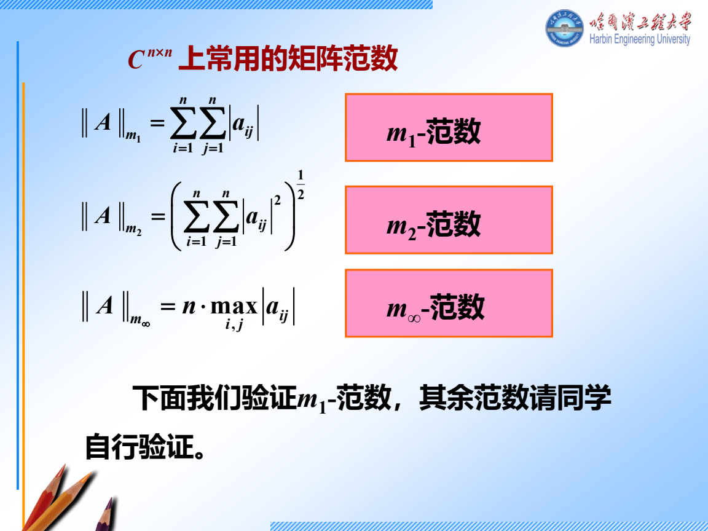

### 跟做 2　Kronecker 积先标块 再记性质

取 \(A=\begin{bmatrix}1&2\\0&-1\end{bmatrix}\)，\(B=[3\ \ 4]\) 是 \(1\times2\)。

1. 先按 \(a_{ij}B\) 作块，第一块行是 \([1B\;\;2B]\)，第二块行是 \([0B\;\;-B]\)。
2. 结果为 \(A\otimes B=\begin{bmatrix}3&4&6&8\\0&0&-3&-4\end{bmatrix}\)。尺寸 \(2\cdot1\) 行、\(2\cdot2\) 列，和结果相符。
3. 这两个因子秩分别是 2、1，所以乘积秩是 2。转置时两边各转置，顺序仍是 \(A^T\otimes B^T\)。
4. 当 \(A,B\) 分别为 \(m,p\) 阶方阵，\(\det(A\otimes B)=(\det A)^p(\det B)^m\)，指数用另一边的阶数。另有 \(\operatorname{tr}(A\otimes B)=\operatorname{tr}(A)\operatorname{tr}(B)\)。看到 \((A\otimes B)(C\otimes D)\) 先检查 \(AC,BD\) 的尺寸，再化成 \(AC\otimes BD\)。

### 跟做 3　2025 哈尔滨 IV 逐块算矩阵偏导

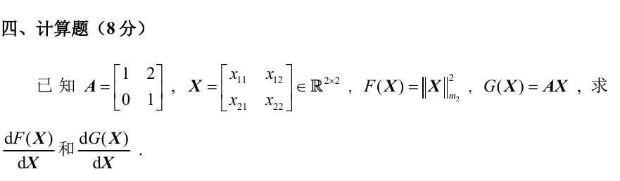

1. **先分输出。** \(F=\|X\|_{m_2}^2=x_{11}^2+x_{12}^2+x_{21}^2+x_{22}^2\) 是一个标量。对每个 \(x_{ij}\) 求偏导，只有对应的平方项留下 \(2x_{ij}\)。按输入位置排成 \(dF/dX=2X\)。
2. **对 \(G=AX\)，先展开。**
   \[
   AX=\begin{bmatrix}x_{11}+2x_{21}&x_{12}+2x_{22}\\x_{21}&x_{22}\end{bmatrix}.
   \]
   每个变量的偏导仍是 \(2\times2\)，所以一共四个 \(2\times2\) 块。
3. **逐变量找出现在哪些位置。** 对 \(x_{11}\) 的块为 \(\begin{bmatrix}1&0\\0&0\end{bmatrix}\)，对 \(x_{12}\) 的块为 \(\begin{bmatrix}0&1\\0&0\end{bmatrix}\)，对 \(x_{21}\) 的块为 \(\begin{bmatrix}2&0\\1&0\end{bmatrix}\)，对 \(x_{22}\) 的块为 \(\begin{bmatrix}0&2\\0&1\end{bmatrix}\)。
4. **按照课件的输入位置摆块。** 左上是 \(\partial G/\partial x_{11}\)，右上是 \(\partial G/\partial x_{12}\)，左下是 \(\partial G/\partial x_{21}\)，右下是 \(\partial G/\partial x_{22}\)。因此
   \[
   \frac{dG}{dX}=\begin{bmatrix}1&0&0&1\\0&0&0&0\\2&0&0&2\\1&0&0&1\end{bmatrix}.
   \]
   也可用 \(AE_{ij}\) 核对每一块，其中 \(E_{ij}\) 只有 \((i,j)\) 为 1。若题目改成对列堆叠向量的 Jacobian，则按题面另行排。
5. **对标量求导时有另一套起手。** \(A(t)\) 逐元素求导，形状不变，\((A^2)'=A'A+AA'\)。检查是否可交换之后才能合并。逐元素积分也是如此。若 \(F(x)=\int_0^{g(x)} A(t)\,dt\)，在被积函数连续的区间用 \(F'(x)=A(g(x))g'(x)\)。

展开课件偏导原例与积分原例

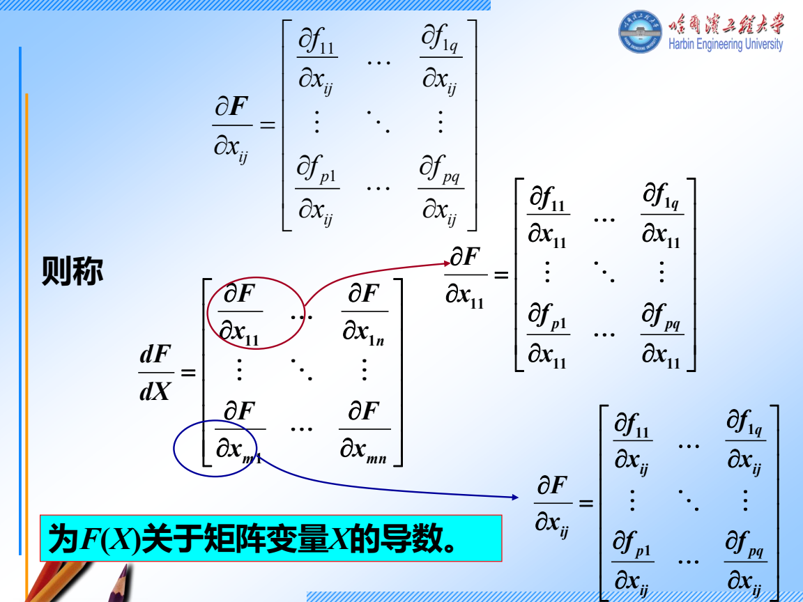

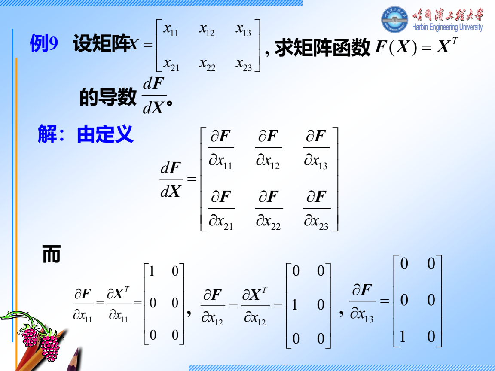

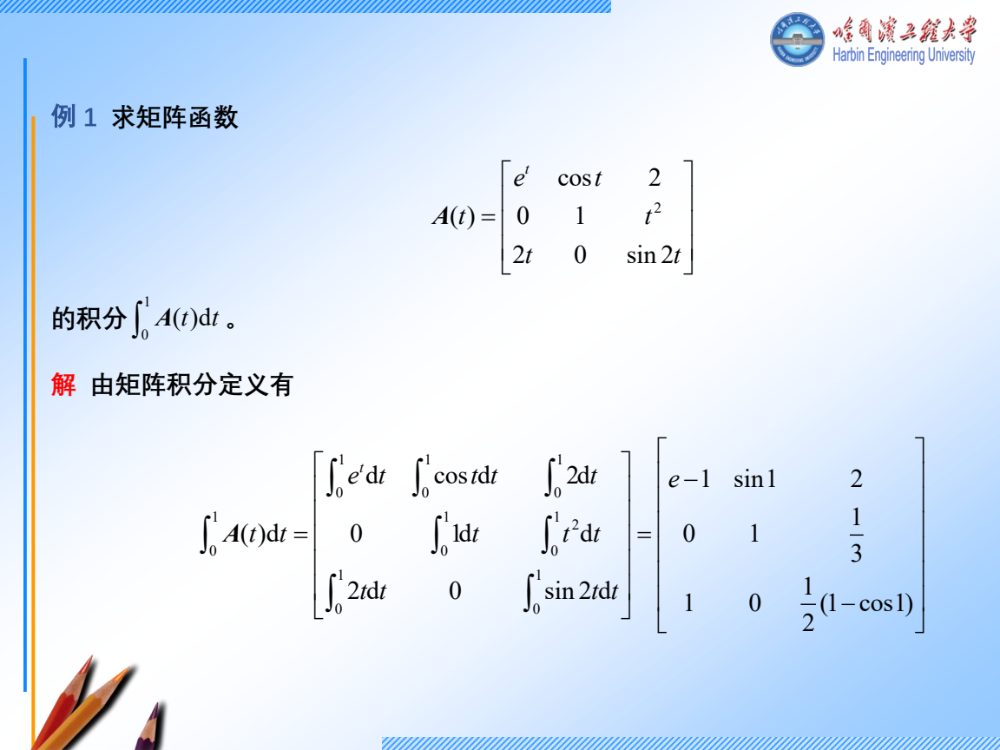

积分原例最后一个积分的订正为 \(\int_0^1\sin(2t)\,dt=(1-\cos2)/2\)。

## 独立练习

前 8 项合计约 30 分钟。先只做题，计一项为一项。F9 另用 12 分钟写完整证明。

### F1　2024 哈尔滨 II.4 辨认范数

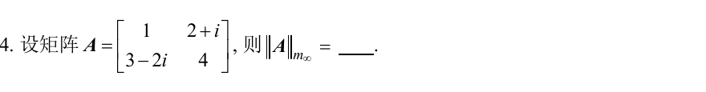

看分步答案

1. 元素模依次是 \(1,\sqrt5,\sqrt{13},4\)。
2. 最大为 4，题目是二阶方阵的 \(m_\infty\)，所以答案是 \(2\cdot4=8\)。

### F2　2024 青岛 II.8 Kronecker 行列式

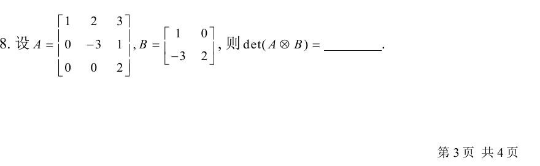

看分步答案

1. 两个因子都是三角阵，行列式为 \(1(-3)2=-6\) 和 \(1\cdot2=2\)。
2. \(A\) 三阶、\(B\) 二阶，故 \(\det(A\otimes B)=(-6)^2\cdot2^3=288\)。

### F3　2024 青岛 II.9 可变上限积分

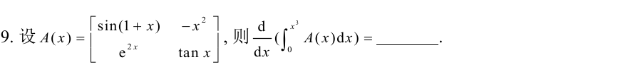

看分步答案

1. 先改积分变量为 \(t\)，写 \(\frac d{dx}\int_0^{x^3}A(t)\,dt\)。
2. 积分上限是 \(x^3\)，先把它代进每个元素，再乘 \(3x^2\)。在积分有定义且连续的区间内结果为
   \[
   3x^2\begin{bmatrix}\sin(1+x^3)&-x^6\\e^{2x^3}&\tan(x^3)\end{bmatrix}.
   \]

### F4　2024 青岛 II.10 对列向量求导

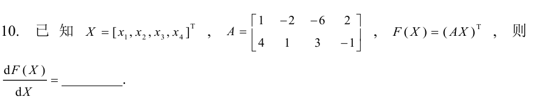

看分步答案

1. \(X\) 有四行一列，\(F=(AX)^T\) 是一行两列。对每个 \(x_i\) 得一个 \(1\times2\) 的行块。
2. \(x_i\) 的系数来自 \(A\) 的第 \(i\) 列，转置后成行，依输入次序向下堆。
3. 按本课排法，答案 \(A^T=\begin{bmatrix}1&4\\-2&1\\-6&3\\2&-1\end{bmatrix}\)，尺寸 \(4\times2\)。

### F5　谱半径和幂级数

令 \(A=\begin{bmatrix}1/2&3\\0&1/2\end{bmatrix}\)。求 \(\rho(A)\) 并判断 \(\sum A^k\) 是否收敛。若收敛，求其和。

看分步答案

1. 三角阵两个特征值均为 \(1/2\)，所以 \(\rho(A)=1/2<1\)，收敛。诱导行和为 \(7/2>1\) 也与此相容。
2. \(I-A=\begin{bmatrix}1/2&-3\\0&1/2\end{bmatrix}\)，求逆得 \(\begin{bmatrix}2&12\\0&2\end{bmatrix}\)。
3. 上右元素核对 \((1/2)\cdot12-3\cdot2=0\)，对角均为 1。

### F6　乘积求导

令 \(A(t)=\begin{bmatrix}t&1\\0&0\end{bmatrix}\)。求 \((A(t)^2)'\)。

看分步答案

1. \(A'=\operatorname{diag}(1,0)\)。\(A'A=\begin{bmatrix}t&1\\0&0\end{bmatrix}\)，\(AA'=\begin{bmatrix}t&0\\0&0\end{bmatrix}\)。
2. 相加得 \(\begin{bmatrix}2t&1\\0&0\end{bmatrix}\)。也可先算 \(A^2=\begin{bmatrix}t^2&t\\0&0\end{bmatrix}\) 再逐项求导。

### F7　2024 哈尔滨 II.6 指数的行列式

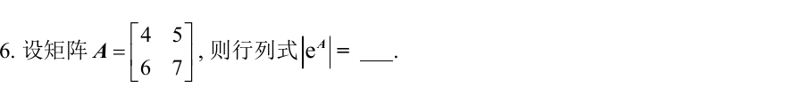

看分步答案

1. \(\det(e^A)=e^{\operatorname{tr}A}\)。因为把 \(A\) 化到三角形后，指数矩阵的对角项是原对角项取指数，相乘就得到迹的指数。
2. \(\operatorname{tr}A=4+7=11\)，答案 \(e^{11}\)。

### F8　复习最大块

某矩阵的块为 \(J_2(-1)\oplus[-1]\oplus[3]\)。写出特征和最小多项式，并说明 \(\cos A\) 要匹配哪些数据。

看分步答案

1. 特征多项式数总大小，得 \((t+1)^3(t-3)\)。最小多项式数每个根的最大块，得 \((t+1)^2(t-3)\)。
2. 在 \(-1\) 匹配 \(\cos(-1)\) 和 \(-\sin(-1)\)，在 \(3\) 只匹配 \(\cos3\)。

### F9　2023 青岛 III 证明诱导矩阵范数

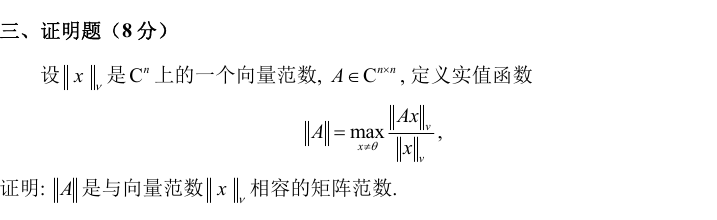

看分步证明

1. 将比值改写为 \(\|y\|_v=1\) 上的 \(\|Ay\|_v\)。有限维单位球面紧且函数连续，最大值存在。
2. 所有比值非负。如果最大值为 0，则每个 \(x\ne0\) 都有 \(Ax=0\)，所以 \(A=0\)。反向直接成立。
3. 数乘时分子的范数提出 \(|c|\)，故 \(\|cA\|=|c|\|A\|\)。
4. 固定 \(x\ne0\)，把 \(\|(A+B)x\|_v\le\|Ax\|_v+\|Bx\|_v\) 两边除以 \(\|x\|_v\)，各比值由对应的最大值控制，再对左边取最大得到三角不等式。
5. 定义直接给出 \(\|Ax\|_v\le\|A\|\|x\|_v\)，\(x=0\) 也成立，故相容。对 \(ABx\) 连用两次得 \(\|ABx\|_v\le\|A\|\|B\|\|x\|_v\)，再除并取最大得到次乘性。

## 当天验收

F1–F8 达到 6 项正确就记录其余两项的第一处错误。低于 6 项时，优先重做范数下标、乘积求导的顺序和分块导数的排法。睡前收好周六要用的模拟卷，不看参考答案。
