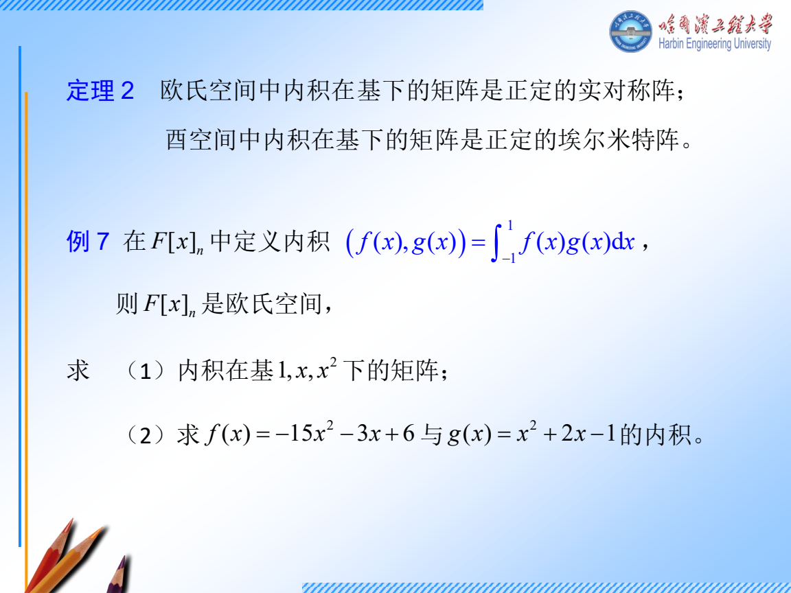
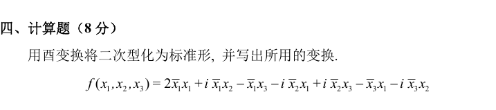
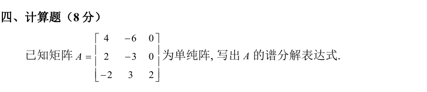
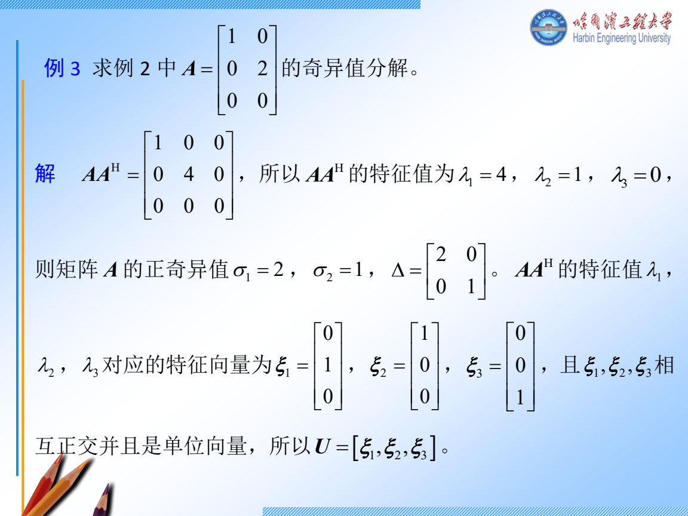
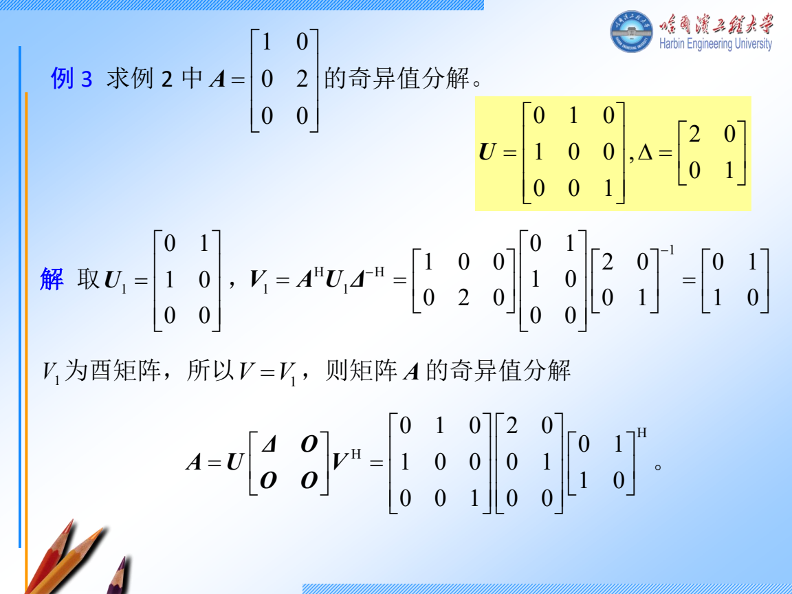
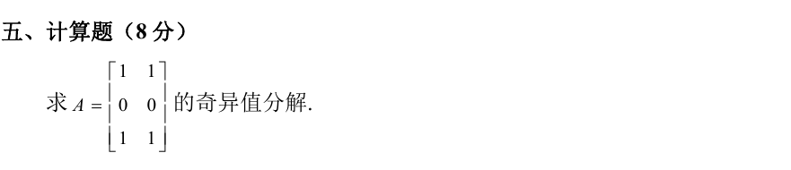
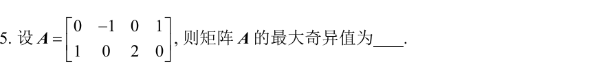
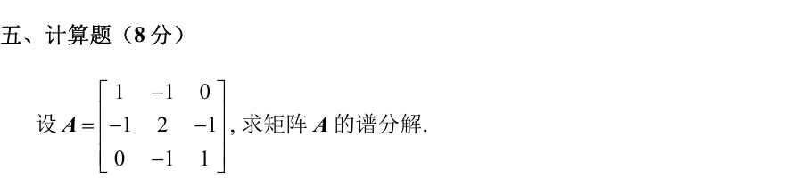

# 周四 11 月 12 日｜内积、谱分解和 SVD

**今天 210 分钟。** 内积与特殊阵 40 分钟，谱分解 50 分钟，SVD 55 分钟，分解条件与练习 50 分钟，最后 15 分钟闭卷检查。只剩 90 分钟时，做跟做 2 和 D1，然后用 D2 区分「只求奇异值」和「交完整分解」。

## 讲义与跟做

### 跟做 1　用内积找到投影，为什么要减掉一个分量

在 \(\operatorname{span}(1,x)\) 中用 \(\langle f,g\rangle=\int_0^1 f(x)g(x)\,dx\)，把 \(1,x\) 正交化。

1. **求两两内积。** \(\langle1,1\rangle=1,\ \langle1,x\rangle=1/2,\ \langle x,x\rangle=1/3\)。按基向量顺序摆出度量矩阵 \(G=\begin{bmatrix}1&1/2\\1/2&1/3\end{bmatrix}\)。坐标列 \(u,v\) 的内积是 \(u^TGv\)。复数题若第一变量共轭线性，就写 \(u^HGv\)。
2. **消去与第一方向重合的部分。** 从 \(x\) 减去 \(c\cdot1\)，要求 \(\langle1,x-c\rangle=0\)。于是 \(1/2-c=0\)，所以投影为 \(1/2\)，正交方向为 \(w=x-1/2\)。
3. **归一。** \(\|w\|^2=\int_0^1(x-1/2)^2dx=1/3-1/2+1/4=1/12\)。因此一组标准正交基是 \(1,\sqrt{12}(x-1/2)\)。
4. **迁移到向量。** 若投影目标向量 \(u\) 尚未归一，实内积下 \(\operatorname{proj}_u v=(u^Tv)/(u^Tu)\,u\)。要求正交补时，对原子空间的每个基向量 \(u_i\) 各列一条 \(u_i^Hv=0\) 再消元。

### 特殊矩阵先看定义

| 名称 | 判定和能用的结论 |
| --- | --- |
| Hermite | \(A^H=A\)，实矩阵时就是对称。特征值都实，可选标准正交特征基。 |
| 酉 | \(A^HA=I\)，即列向量标准正交。若 \(Av=\lambda v\)，两边取 2 范数得 \(|\lambda|=1\)。 |
| 正规 | \(AA^H=A^HA\)。在复数域等价于可酉对角化，包含 Hermite 与酉矩阵。 |
| Hermite 正定 | \(x^HAx>0\) 对每个非零 \(x\) 成立。可查全体特征值为正，或全部顺序主子式为正。 |

**二次型怎么做。** 若 \(A=\begin{bmatrix}2&1\\1&2\end{bmatrix}\)，\(\chi_A(t)=(t-2)^2-1\)，根是 3、1。分别取单位向量 \((1,1)^T/\sqrt2,(1,-1)^T/\sqrt2\)，拼成 \(U\)。设 \(x=Uy\)，则 \(x^TAx=y^TU^TAUy=3y_1^2+y_2^2\)。两个系数都正，也可验顺序主子式 \(2,3>0\)。复数二次型同样写 \(x=Uy\) 和 \(U^HAU\)。

### 跟做补讲　2022 哈尔滨 IV，复二次型怎样写成对角形

1. **把 \(\bar x_i x_j\) 的系数放在第 \(i\) 行第 \(j\) 列。** 比如 \(i\bar x_1x_2\) 给出 \(a_{12}=i\)，而 \(-i\bar x_2x_1\) 给出 \(a_{21}=-i\)。按这个规则逐项填写，题目的二次型就是 \(x^HAx\)，其中
   \[
   A=\begin{bmatrix}2&i&-1\\-i&0&i\\-1&-i&0\end{bmatrix}.
   \]
   对角是实数，上下对称位置互为共轭，因此 \(A^H=A\)。
2. **先求特征值。** 沿 \(tI-A\) 第一行展开，得到 \((t-2)(t^2-1)-(t+1)-(t+1)=t(t+1)(t-3)\)。所以三个特征值是 \(-1,0,3\)。
3. **每个特征值分别解一次方程。**
   - 当 \(t=-1\)，第二行给 \(x_2=i(x_1-x_3)\)，代入第一行得 \(2x_1=0\)。取 \(x_3=1\)，得到 \(v_{-1}=(0,-i,1)^T\)。
   - 当 \(t=0\)，第二行给 \(x_3=x_1\)，第三行给 \(x_2=ix_1\)。取 \(x_1=1\)，得到 \(v_0=(1,i,1)^T\)。
   - 当 \(t=3\)，第一行给 \(x_3=-x_1+ix_2\)。代入第二行得 \(-2ix_1-4x_2=0\)，所以 \(x_2=-ix_1/2,\ x_3=-x_1/2\)。取 \(x_1=2\)，得到 \(v_3=(2,-i,-1)^T\)。
4. **归一并写出变换。** 复向量的长度平方是各分量模平方之和，例如 \(v_{-1}\) 的长度是 \(\sqrt{0+1+1}=\sqrt2\)。三个长度依次为 \(\sqrt2,\sqrt3,\sqrt6\)。由于 \(A\) 是 Hermite 矩阵，三个不同特征值对应的特征向量已正交。取
   \[
   U=\left[\frac{v_{-1}}{\sqrt2},\,\frac{v_0}{\sqrt3},\,\frac{v_3}{\sqrt6}\right],\qquad x=Uy.
   \]
5. **交卷时把变换和标准形都写出。** 由 \(U^HAU=\operatorname{diag}(-1,0,3)\)，有 \(x^HAx=-|y_1|^2+3|y_3|^2\)。验算时用 \(Av_j=\lambda_jv_j\)，并记住 \(v_j^H\) 要先共轭再转置。

### 跟做 2　2024 青岛 IV，一般可对角化矩阵怎样求谱分解

1. **求不同特征值。** \(tI-A\) 的第三列只有 \(t-2\)。左上二阶块的行列式是 \((t-4)(t+3)+12=t(t-1)\)。所以不同特征值为 \(0,1,2\)，三根互异，矩阵可对角化。
2. **为每个特征空间做一个开关。** \(P_1\) 要在特征值 1 的向量上原样返回，在另外两种上变成零。令 \(p_1(t)=t(t-2)/(1\cdot(-1))\)，它在 \(0,1,2\) 取值 \(0,1,0\)，所以 \(P_1=p_1(A)=2A-A^2\)。同理 \(P_2=(A^2-A)/2,\ P_0=I-P_1-P_2\)。
3. **实际相乘。** 先算 \(A^2=\begin{bmatrix}4&-6&0\\2&-3&0\\-6&9&4\end{bmatrix}\)。例如第三行第一项为 \((-2)4+3\cdot2+2(-2)=-6\)。因此
   \[
   P_0=\begin{bmatrix}-3&6&0\\-2&4&0\\0&0&0\end{bmatrix},\quad
   P_1=\begin{bmatrix}4&-6&0\\2&-3&0\\2&-3&0\end{bmatrix},\quad
   P_2=\begin{bmatrix}0&0&0\\0&0&0\\-2&3&1\end{bmatrix}.
   \]
4. **写谱分解和验算。** \(A=0P_0+P_1+2P_2\)。检查 \(P_0+P_1+P_2=I\)，而 \(P_1+2P_2\) 的第三行是 \((2,-3,0)+2(-2,3,1)=(-2,3,2)\)。投影在一组特征基上分别只保留自己的特征空间，所以 \(P_i^2=P_i\)，且 \(P_iP_j=0\)（\(i\ne j\)）。本题投影一般不对称。正规矩阵才可以用各特征空间的标准正交基写 \(P_i=\sum_j u_{ij}u_{ij}^H\)。

### 跟做 3　先按 PPT 原例学完整 SVD

1. 原例 \(A=\begin{bmatrix}1&0\\0&2\\0&0\end{bmatrix}\) 是 \(3\times2\)。完整分解中 \(U\) 是 \(3\times3\)，\(\Sigma\) 是 \(3\times2\)，\(V\) 是 \(2\times2\)。
2. 计算 \(A^TA=\begin{bmatrix}1&0\\0&4\end{bmatrix}\)。按特征值从大到小排列 \(4,1\)，开根得奇异值 \(2,1\)。对应右向量 \(v_1=e_2,v_2=e_1\)。
3. 算 \(Av_1=2e_2,Av_2=e_1\)。两边除对应奇异值，得 \(u_1=e_2,u_2=e_1\)（这里的 \(e_i\) 属于 \(\mathbb R^3\)）。补 \(u_3=e_3\) 得完整的 \(U\)。
4. 写 \(U=[e_2,e_1,e_3],\ V=[e_2,e_1],\ \Sigma=\begin{bmatrix}2&0\\0&1\\0&0\end{bmatrix}\)。验 \(AV\) 和 \(U\Sigma\) 都是按列 \([2e_2,e_1]\)，所以 \(A=U\Sigma V^T\)。对零奇异值，\(Av_i=0\)，左向量要补在已有左向量的正交补里。

看第四章 P25 的原课件续解

### 其他分解怎样起手

- **LU/LDU。** 取 \(A=\begin{bmatrix}2&1\\4&5\end{bmatrix}\)。第二行减第一行的两倍得 \(U=\begin{bmatrix}2&1\\0&3\end{bmatrix}\)。消元乘数 2 写进 \(L=\begin{bmatrix}1&0\\2&1\end{bmatrix}\)，乘回 \(LU=A\)。要 LDU，再从 \(U\) 左边提出 \(D=\operatorname{diag}(2,3)\)，余下单位上三角阵。不换行时先看主元，交换矩阵可逆却不能直接作这种 LU。
- **Cholesky。** 对称正定的 \(B=\begin{bmatrix}4&2\\2&2\end{bmatrix}=LL^T\)。第一列从 \(l_{11}^2=4\) 取正根 2，\(l_{21}l_{11}=2\) 得 1。第二个对角由 \(l_{21}^2+l_{22}^2=2\) 得 \(l_{22}=1\)。验 \(L=\begin{bmatrix}2&0\\1&1\end{bmatrix}\) 可乘回。
- **UR/QR。** 对各列做施密特。以 \(a_1=(1,1)^T,a_2=(1,-1)^T\) 为例，两列已正交，\(q_i=a_i/\sqrt2\)，\(R=\sqrt2 I\)。一般第二列先减 \(q_1(q_1^Ha_2)\) 再归一，\(r_{12}=q_1^Ha_2\)。
- **满秩分解。** \(\begin{bmatrix}1&2\\3&6\end{bmatrix}=(1,3)^T[1\ \ 2]\)。左因子取原阵的独立列，右因子记录每个原列的坐标。两个因子的秩都等于 \(r=1\)。

## 独立练习

### D1　2024 青岛 V 完整 SVD，限时 12 分钟

看分步答案

1. 两列都是 \((1,0,1)^T\)，两列的内积都等于 2，故 \(A^TA=\begin{bmatrix}2&2\\2&2\end{bmatrix}\)。
2. \((1,1)^T\) 经该矩阵变为自身的 4 倍，\((1,-1)^T\) 变为零。归一后取 \(v_1=(1,1)^T/\sqrt2,\ v_2=(1,-1)^T/\sqrt2\)，奇异值为 \(2,0\)。
3. \(Av_1=\sqrt2(1,0,1)^T\)，除 2 得 \(u_1=(1,0,1)^T/\sqrt2\)。取 \(u_2=e_2,\ u_3=(1,0,-1)^T/\sqrt2\)，三列单位且彼此正交。
4. \(U=[u_1,u_2,u_3],\ V=[v_1,v_2],\ \Sigma=\begin{bmatrix}2&0\\0&0\\0&0\end{bmatrix}\)。核对 \(AV=[2u_1,0]\)，与 \(U\Sigma\) 相同。单独写「2、0」只回答了奇异值。

### D2　2024 哈尔滨 II.5 最大奇异值，限时 4 分钟

看分步答案

1. \(A\) 只有两行，算更小的 \(AA^T\)。两行的平方长度分别为 2、5，内积为 0。
2. 所以 \(AA^T=\operatorname{diag}(2,5)\)，最大特征值 5。\(AA^T\) 与 \(A^TA\) 的正特征值相同。
3. 开根得到 \(\sigma_{\max}=\sqrt5\)。题目只问这个数，到此即可。

### D3　2024 哈尔滨 V 实对称矩阵的谱分解，限时 12 分钟

看分步答案

1. 每行和为零，故 \(b_0=(1,1,1)^T\) 对应 0。试首尾反向的 \(b_1=(1,0,-1)^T\)，相乘得 \(Ab_1=b_1\)。
2. 要找垂直于前两列的方向，令 \(b_3=(a,b,c)^T\)。由 \(a-c=0,\ a+b+c=0\)，取 \(a=c=1,b=-2\)，得到 \(b_3=(1,-2,1)^T\)，且 \(Ab_3=(3,-6,3)^T=3b_3\)。
3. 三列归一后的投影分别是 \(P_0=b_0b_0^T/3,\ P_1=b_1b_1^T/2,\ P_3=b_3b_3^T/6\)。因此 \(A=0P_0+P_1+3P_3\)。
4. 验第一行第一项 \(1/2+3/6=1\)，第一行第二项 \(0-6/6=-1\)，第一行第三项 \(-1/2+3/6=0\)，与原阵相符。剩余元素可按同法核对。

## 当天验收

说出从 \(A\) 本身的特征值建谱投影、从 \(A^HA\) 的特征值开根这两条路径。闭卷交出 D1 的三个因子，并在 D3 中检查投影权重。碰到尺寸或左右向量弄反，明天先写一遍 \(AV=U\Sigma\)。
