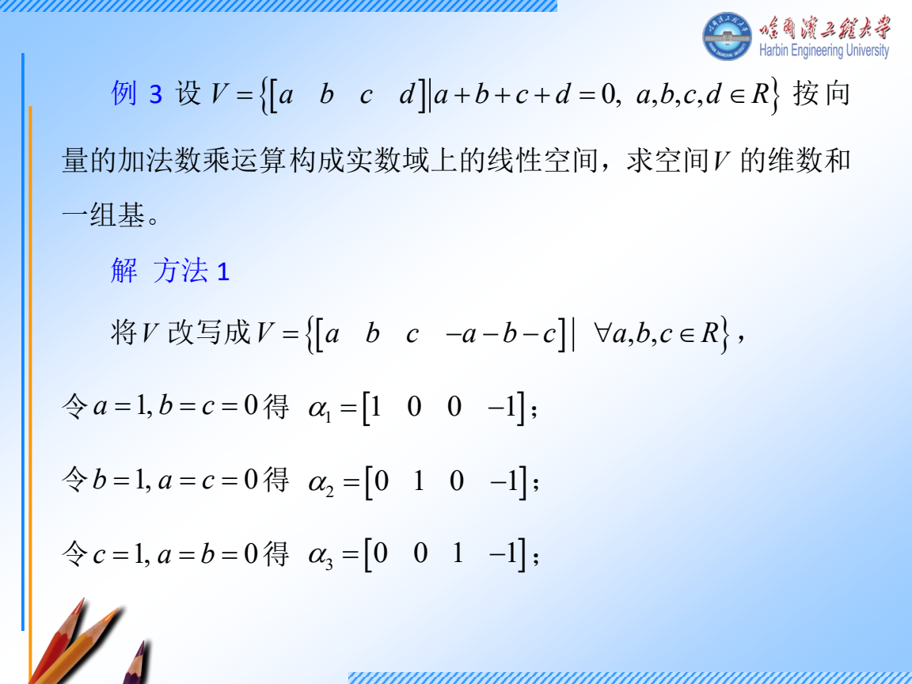
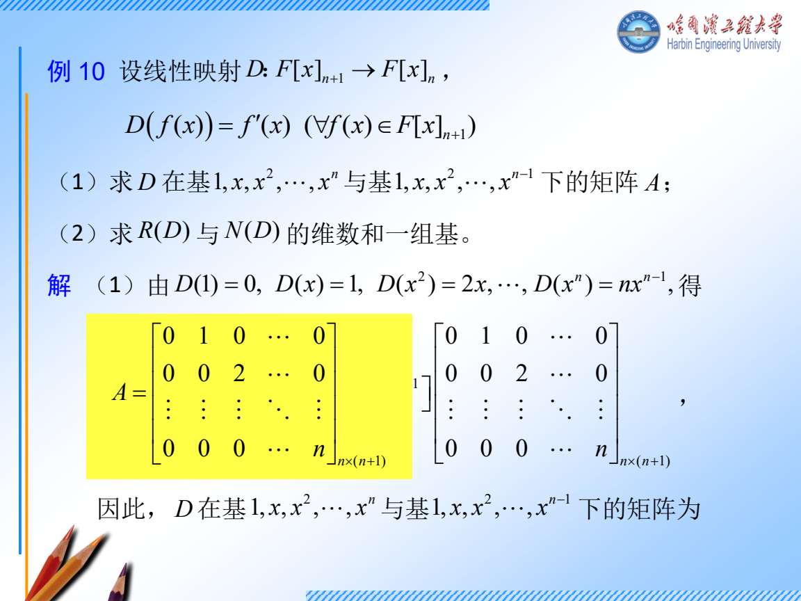
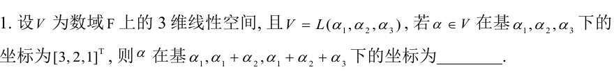
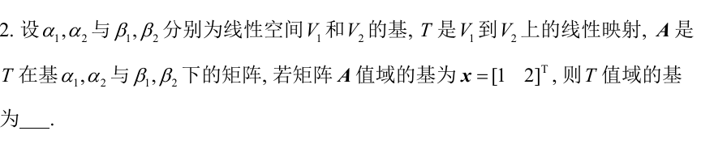
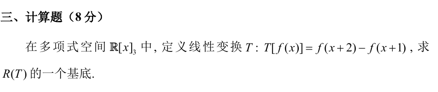

# 周二 11 月 10 日｜从消元走到第一条若当链

**今天 130 分钟。** 消元和基 35 分钟，坐标和映射 30 分钟，特征向量与第一条链 40 分钟，独立练习和验收 25 分钟。只剩 90 分钟时，做跟做 1、3 和真题 T1、T2，最后口述映射矩阵怎么按列排。今天优先解决明天做综合题必须用的动作。

## 讲义与跟做

### 跟做 1　消元以后怎样写出一组基

给 \(B=\begin{bmatrix}1&2&1\\2&4&2\end{bmatrix}\)，求 \(\ker B\)、\(\operatorname{im}B\) 的一组基。

1. **先分清问的对象。** \(\ker B=\{x:Bx=0\}\)，它在输入空间 \(\mathbb R^3\)。\(\operatorname{im}B=\{Bx:x\in\mathbb R^3\}\)，它在输出空间 \(\mathbb R^2\)。因此前者的基向量有三个分量，后者只有两个。
2. **消掉重复方程。** 第二行减第一行的两倍，系数矩阵变成 \(\begin{bmatrix}1&2&1\\0&0&0\end{bmatrix}\)。第一列有主元，所以第一变量由方程决定。第二、三变量可任取。
3. **把自由变量分开。** 令 \(x_2=s,x_3=t\)，则 \(x_1=-2s-t\)。所以
   \[
   x=\begin{bmatrix}-2s-t\\s\\t\end{bmatrix}
   =s\begin{bmatrix}-2\\1\\0\end{bmatrix}+t\begin{bmatrix}-1\\0\\1\end{bmatrix}.
   \]
   这两个向量的第二、三分量分别是 \((1,0)\)、\((0,1)\)，故线性无关。全体解也都由它们生成，所以它们是一组基。基的向量个数就是维数。
4. **回原阵找像空间。** \(Bx=x_1b_1+x_2b_2+x_3b_3\)，因此像由原列向量张成。第一列是主元列，回原阵取 \(b_1=(1,2)^T\)。后两列分别是它的两倍和一倍。
5. **核对。** 两个核向量逐一代回 \(Bx=0\)。秩是 1，零度是 2，和是输入维数 3。行变换保留方程的解，找像的基时取原阵相应的列。

### 跟做 2　为什么表示矩阵的第 \(j\) 列是第 \(j\) 个基向量的像

输入、输出都用 \(\beta=(1+x,x)\)，映射 \(T(f)=f'\)。先求表示矩阵，再求 \(T(2+x)\) 在这组基下的坐标。

1. 求输入基的像。\(T(1+x)=1,\ T(x)=1\)。
2. 两个像都必须写成输出基的线性组合。因为 \(1=(1+x)-x\)，两列坐标都是 \((1,-1)^T\)，所以 \(M=\begin{bmatrix}1&1\\-1&-1\end{bmatrix}\)。
3. 输入也要用相同的坐标约定。\(2+x=2(1+x)-x\)，输入坐标是 \((2,-1)^T\)。相乘得 \(M(2,-1)^T=(1,-1)^T\)。
4. 把结果还原成多项式得 \(1+x-x=1\)，和直接求导一致。矩阵的两列说明分别喂进去第一、第二个基向量时会得到什么。输入一般向量时，线性性保证可以按输入坐标加权。

**换基写法。** 如果 \(P\) 的第 \(j\) 列是新基向量在旧基中的坐标，先写 \([v]_{\rm 旧}=P[v]_{\rm 新}\)。这是一条由「按系数拼向量」得到的等式。对同一空间的映射，新基矩阵是 \(P^{-1}AP\)。输入和输出分别用 \(P,Q\) 换基时得到 \(Q^{-1}AP\)。

### 跟做 3　从一个特征向量补出第二列

给 \(A=\begin{bmatrix}2&0\\3&2\end{bmatrix}\)，求特征向量，再找 \(T,J\) 使 \(AT=TJ\)。

1. **读重数。** 三角阵的特征多项式是 \(\det(tI-A)=(t-2)^2\)。这表示特征值 2 占两维，接着还要看能找出几个独立特征向量。
2. **解齐次方程。** \(N=A-2I=\begin{bmatrix}0&0\\3&0\end{bmatrix}\)。令 \(v=(v_1,v_2)^T\)，\(Nv=0\) 的第二行是 \(3v_1=0\)，第一行恒为零。故 \(v_1=0,v_2\) 自由，取 \(v=(0,1)^T\)。只有一维特征空间。
3. **给同一条链补第二个方向。** 要求 \(Nw=v\)。令 \(w=(w_1,w_2)^T\)，第二行给 \(3w_1=1\)，第一行给 \(0=0\)，故 \(w_1=1/3\)，取 \(w_2=0\)。
4. **按链的顺序排。** \(Av=2v,\ Aw=v+2w\)。所以 \(T=[v,w]=\begin{bmatrix}0&1/3\\1&0\end{bmatrix}\)，在这组基里 \(J\) 的第一列是 \((2,0)^T\)，第二列是 \((1,2)^T\)。因此 \(J=\begin{bmatrix}2&1\\0&2\end{bmatrix}\)。
5. **验算。** \(\det T=-1/3\ne0\)。\(AT\) 的两列刚好是 \(2v\) 和 \(v+2w\)，与 \(TJ\) 逐列相等。

### 小题条件表

- 同一数域、同一运算下，验证子空间要有零向量，并对加法和数乘封闭。比如所有可逆矩阵缺零矩阵，直接排除。判断集合是数域则另查乘法和非零元素的逆。
- 和空间的基从两组生成元合起来消元。交空间让两个参数式相等，再还原公共向量。两个子空间直和当且仅当交为 \(\{0\}\)。例如 \(\mathbb R^2\) 中两个坐标轴直和，\(x e_1+y e_2\) 的两部分分别由 \(x,y\) 唯一确定。
- \(W\) 对 \(T\) 不变是指 \(T(W)\subseteq W\)。验一组基的像即可，因为其余向量的像是这些像的线性组合。对上面的 \(A\)，\(W=\operatorname{span}(e_2)\) 不变，因为 \(Ae_2=2e_2\)。

**复数小补充。** 先会把 \(a+bi\) 的虚部变号，得到共轭 \(a-bi\)，再会取模 \(\sqrt{a^2+b^2}\)。例如 \(\overline{2+i}=2-i,\ |2+i|=\sqrt5\)。\(A^H\) 表示对矩阵每个元素取共轭再转置。[周四复二次型补讲](thursday.html#跟做补讲-2022-哈尔滨-iv复二次型怎样写成对角形) · [周五复矩阵范数](friday.html#f1-2024-哈尔滨-ii4-辨认范数)

## 独立练习

### T1　2024 青岛 II.1 换基，限时 5 分钟

看分步答案

1. 三个新基向量依次写在旧基下，列矩阵是 \(P=\begin{bmatrix}1&1&1\\0&1&1\\0&0&1\end{bmatrix}\)。
2. 设所求坐标为 \(y\)。用旧基坐标还原同一个向量，\(Py=(3,2,1)^T\)。
3. 从下往上，\(y_3=1,\ y_2=2-1=1,\ y_1=3-1-1=1\)。所以答案是 \((1,1,1)^T\)。
4. 把三个新基各取一份相加，得到 \(3\alpha_1+2\alpha_2+\alpha_3\)，和旧坐标一致。

### T2　2024 哈尔滨 II.2 核像与坐标，限时 4 分钟

看分步答案

1. \(A\) 的像空间是坐标空间，所以题面给的 \((1,2)^T\) 表示在输出基 \((\beta_1,\beta_2)\) 中的两个系数。
2. 按输出基还原，得到 \(v=\beta_1+2\beta_2\)。
3. 坐标对应是一一对应的线性映射，因此一维像空间的基还原后仍是一组基。答案写为 \(\{\beta_1+2\beta_2\}\)。

### T3　2025 哈尔滨 III 求多项式映射的值域，限时 10 分钟

看分步答案

1. 取输入基 \(1,x,x^2\)。常数的像是 \(1-1=0\)。
2. 一次项的像是 \((x+2)-(x+1)=1\)。
3. 二次项的像是 \((x^2+4x+4)-(x^2+2x+1)=2x+3\)。
4. \(1\) 和 \(2x+3\) 线性无关，因为第二个有非零 \(x\) 项。所有像都由它们张成，故 \(\{1,2x+3\}\) 是值域的一组基，\(\{1,x\}\) 也可以。

### T4　换一组数字接链，限时 6 分钟

把跟做 3 的 \(A\) 改成 \(\begin{bmatrix}4&-2\\0&4\end{bmatrix}\)。求一组 \(v,w,T,J\)。

看分步答案

1. \(N=A-4I=\begin{bmatrix}0&-2\\0&0\end{bmatrix}\)。解 \(Nv=0\) 得 \(v_2=0\)，取 \(v=e_1\)。
2. \(Nw=v\) 给出 \(-2w_2=1\)。取 \(w_1=0\)，得 \(w=(0,-1/2)^T\)。
3. \(T=\operatorname{diag}(1,-1/2)\)，\(J=\begin{bmatrix}4&1\\0&4\end{bmatrix}\)。验证 \(Aw=v+4w\)，即可确认第二列的符号。

## 当天验收

闭卷写下「主元列回原阵」「新基列乘新坐标等于旧坐标」「\(Nv=0,Nw=v\)」。每句配一个今晚算出来的例子。基础仍卡住时，明天开始的前 15 分钟只重做跟做 1 和跟做 3 的第 2、3 步。
