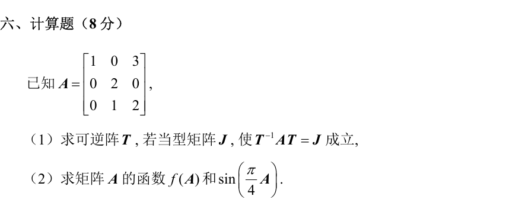
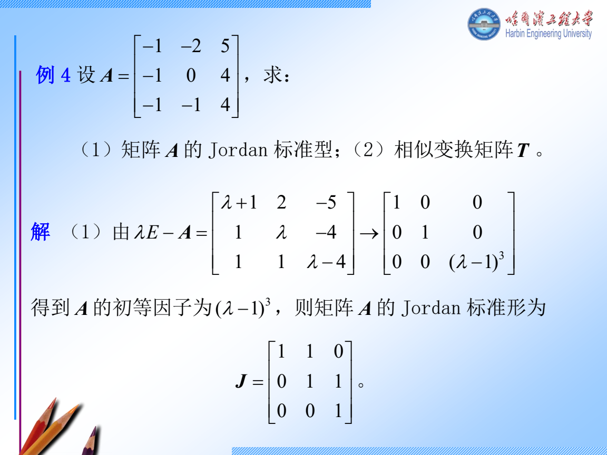
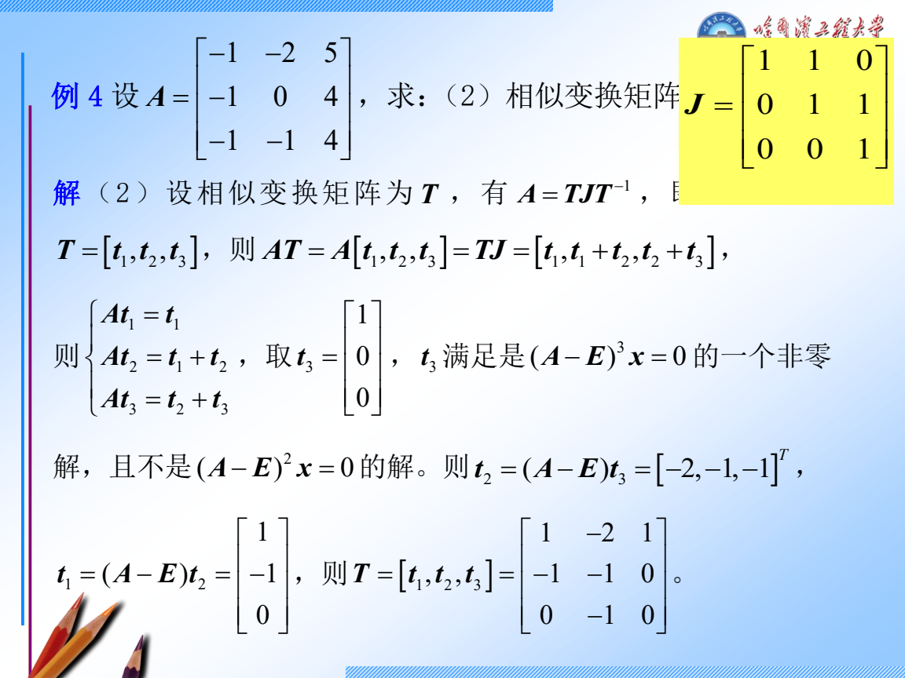
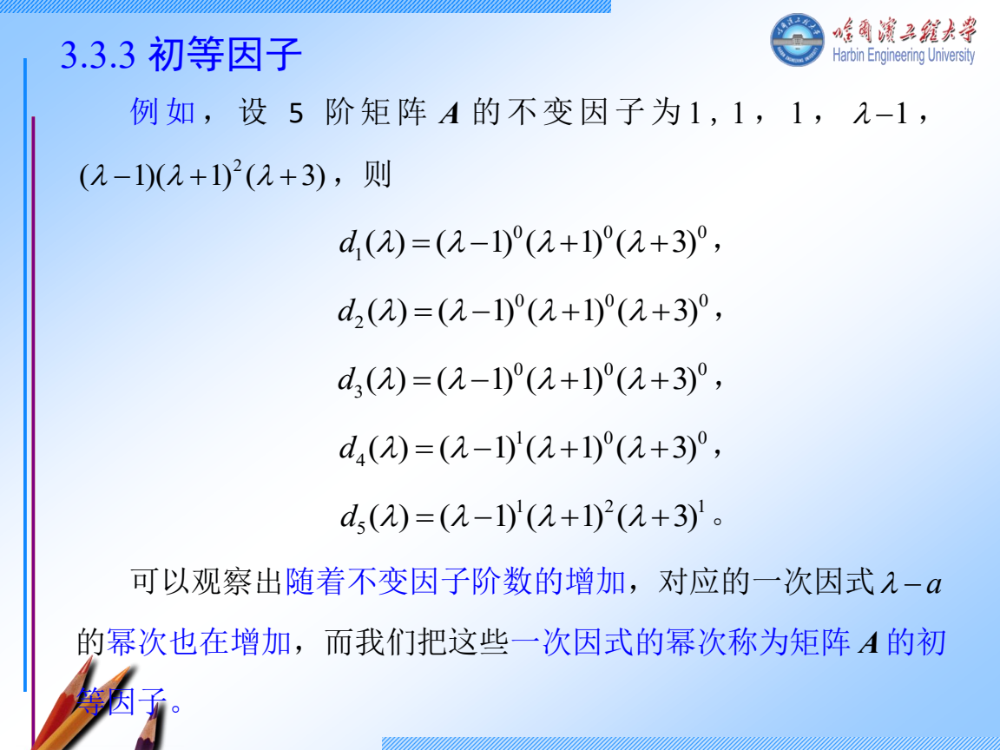
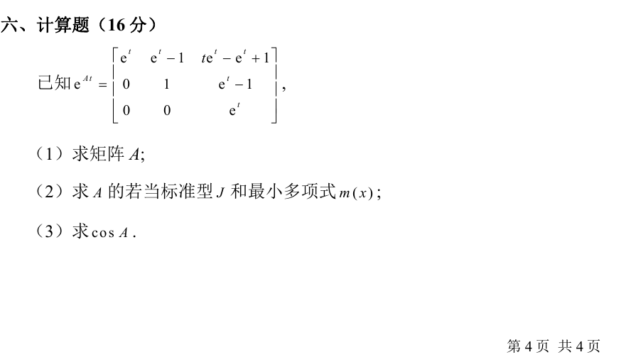
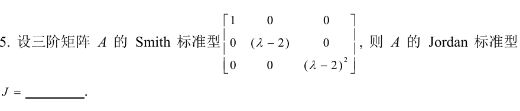
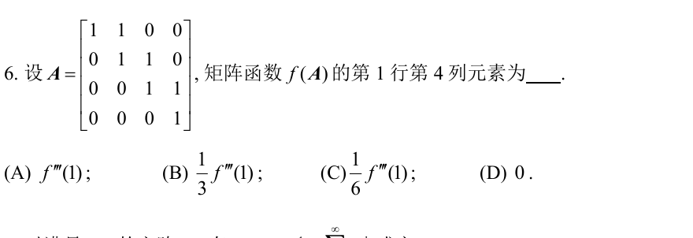
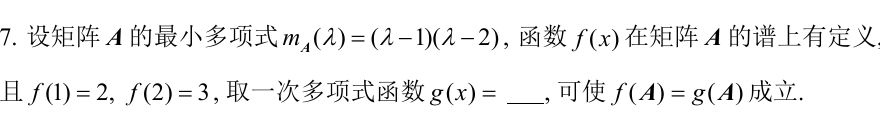

# 周三 11 月 11 日｜若当形、最小多项式和矩阵函数

**今天 210 分钟。** 若当链 55 分钟，Smith 和多项式 45 分钟，矩阵函数 55 分钟，真题 45 分钟，闭卷复盘 10 分钟。只有 90 分钟时，先做跟做 1、跟做 3 的前四步，再独立完成 W1、W2。若当和矩阵函数各有 9 道历年计算题，今天要练完整书写。

## 讲义与跟做

### 跟做 1　2024 哈尔滨 VI 求 \(J,T\) 及矩阵正弦

1. **先找特征值和代数重数。** 沿 \(tI-A\) 的第一列展开。左上角是 \(t-1\)，下面两项为零，剩下的 \(2\times2\) 子式行列式是 \((t-2)^2\)。所以 \(\chi_A(t)=(t-1)(t-2)^2\)。
2. **求 \(\lambda=1\) 的向量。** \(A-I\) 第二行给 \(x_2=0\)，第三行给 \(x_2+x_3=0\)，故 \(x_3=0\)。取 \(u=e_1\)。
3. **求 \(\lambda=2\) 的普通特征向量。** \(N=A-2I=\begin{bmatrix}-1&0&3\\0&0&0\\0&1&0\end{bmatrix}\)。解 \(Nv=0\)，第三行给 \(v_2=0\)，第一行给 \(v_1=3v_3\)。取 \(v_3=1\)，得到 \(v=(3,0,1)^T\)。特征空间只有一维，二重根必须对应一块 \(J_2(2)\)。
4. **解链的第二步。** \(Nw=v\) 给 \(w_2=1,\ -w_1+3w_3=3\)。取 \(w_3=1\)，得 \(w=(0,1,1)^T\)。核对 \(Nw=(3,0,1)^T\)。
5. **作列并核对。** \(T=[u,v,w]\)，\(J=\operatorname{diag}(1,J_2(2))\)。\(\det T=-1\)。逐列计算 \(Au=u,Av=2v,Aw=v+2w\)，故 \(AT=TJ\)。最低化零式取各特征值的最大块，\(m_A(t)=(t-1)(t-2)^2\)。
6. **在简单块和二阶块上算函数。** 一阶块给 \(f(1)\)。二阶块写成 \(2I+S,\ S=\begin{bmatrix}0&1\\0&0\end{bmatrix}\)，因为 \(S^2=0\)，二阶及以上的泰勒项全部消失。所以
   \[
   f(A)=T\begin{bmatrix}f(1)&0&0\\0&f(2)&f'(2)\\0&0&f(2)\end{bmatrix}T^{-1}.
   \]
7. **代指定的正弦函数。** \(f(x)=\sin(\pi x/4)\)，故 \(f(1)=\sqrt2/2,\ f(2)=1,\ f'(2)=(\pi/4)\cos(\pi/2)=0\)。直接写成 \(T\operatorname{diag}(\sqrt2/2,1,1)T^{-1}\)。若需要原坐标矩阵，解 \(T(a,b,c)^T=(x_1,x_2,x_3)^T\) 得 \(c=x_2,b=x_3-x_2,a=x_1+3x_2-3x_3\)。令 \(s=\sqrt2/2\)，乘回得到
   \[
   \sin(\tfrac\pi4 A)=\begin{bmatrix}s&3(s-1)&3(1-s)\\0&1&0\\0&0&1\end{bmatrix}.
   \]

**遇到更大的块。** 设 \(d_k=\dim\ker(A-\lambda I)^k,\ d_0=0\)。一个大小 \(s\) 的 \(\lambda\) 块对 \(d_k\) 贡献 \(\min(k,s)\)。所以 \(d_k-d_{k-1}\) 数的是大小至少为 \(k\) 的块。例如 \(d_1=2,d_2=3,d_3=4\)，差为 \(2,1,1\)，得到一个三阶块和一个一阶块。接三阶链时，先挑 \(w\in\ker N^3\) 且 \(N^2w\ne0\)，再按 \(N^2w,Nw,w\) 作列。多条链选完后还要验列独立。

展开第三章三阶链 PPT 原例和续解

### 跟做 2　Smith 形、三类因子和高次降幂

以 \(\operatorname{diag}(1,t-2,(t-2)^2)\) 为例。

1. 对特征矩阵 \(tI-A\)，\(D_k\) 指所有 \(k\) 阶子式的首一最大公因式。令 \(D_0=1\)，则不变因子 \(d_k=D_k/D_{k-1}\)。例如这里的 \(D_1=1,\ D_2=t-2,\ D_3=(t-2)^3\)。对角阵二阶非零子式里有 \(1\cdot(t-2)\)，其余都能被它整除。
2. 从 Smith 对角线直接读不变因子 \(1,t-2,(t-2)^2\)。丢掉 1，把每个非平凡因子按不同根拆成幂，得到两个初等因子 \(t-2,(t-2)^2\)。所以 \(J=J_1(2)\oplus J_2(2)\)。若反过来从块出发，同一根的指数从小到大排，各根向右对齐，短行左边补 0，再按列相乘。最后再补 1 到矩阵阶数。
3. 特征多项式为 \((t-2)^3\)，最低化零式为 \((t-2)^2\)。特征多项式由 Cayley–Hamilton 定理也能化零。相似判断需要完整的因子或块信息，仅凭最大块不够。
4. 举例算 \(A^3\)。令 \(N=A-2I\)，则 \(N^2=0\)。\((2I+N)^3=8I+12N+6N^2+N^3=12A-16I\)。一般多项式题把 \(p(t)\) 除以 \(m_A(t)\)，余式代回即可，因为商乘 \(m_A(A)\) 为零。
5. 只求某一不变因子时可以尽早结束。若阵中已有非零常数元素，便有 \(D_1=1\)。若又能找到一个非零常数二阶子式，便有 \(D_2=1\)，不用枚举所有子式。练这个动作可用 [2025 哈尔滨 II.8 原题](../evidence/2025-H/II-8.png)。选第 2、3 行，第 1、2 列的子式，行列式为 \(2\cdot3-0=6\)，所以 \(d_2=1\)。

### 跟做 3　2024 青岛 VI 从 \(e^{At}\) 反求 \(A\)，再求 \(\cos A\)

1. \(e^{At}=I+tA+\tfrac{t^2}{2}A^2+\cdots\)。逐项求导后在 \(t=0\) 取值，只留下 \(A\)。原卷 \((1,2)\) 项 \(e^t-1\) 在 0 的导数是 1。\((1,3)\) 项 \(te^t-e^t+1\) 的导数是 \(te^t\)，在 0 等于 0。其余条目同样求导，得
   \[
   A=\begin{bmatrix}1&1&0\\0&0&1\\0&0&1\end{bmatrix}.
   \]
2. 上三角的对角线是 \(1,0,1\)，故 \(\chi_A(t)=t(t-1)^2\)。解 \((A-I)x=0\) 时第一行给 \(x_2=0\)，第二行给 \(-x_2+x_3=0\)，于是 \(x_3=0\)。特征值 1 只有一维特征空间，所以 \(J=J_2(1)\oplus[0]\)，\(m_A(t)=t(t-1)^2\)。
3. **决定匹配什么。** 0 对应一阶块，只用 \(\cos0=1\)。1 对应二阶块，除了 \(\cos1\) 还要 \(-\sin1\)。取二次多项式 \(r(t)=1+a t+b t(t-1)\)，它已自动满足 \(r(0)=1\)。
4. **逐一求系数。** \(r(1)=1+a=\cos1\)，故 \(a=\cos1-1\)。\(r'(t)=a+b(2t-1)\)，在 1 处有 \(a+b=-\sin1\)，故 \(b=1-\cos1-\sin1\)。
5. **代入原矩阵。** \(A^2=\begin{bmatrix}1&1&1\\0&0&1\\0&0&1\end{bmatrix}\)，所以 \(A^2-A\) 仅 \((1,3)\) 为 1。由匹配条件，\(r\) 在每个块上与余弦的值相同，因此
   \[
   \cos A=I+aA+b(A^2-A)
   =\begin{bmatrix}\cos1&\cos1-1&1-\cos1-\sin1\\0&1&\cos1-1\\0&0&\cos1\end{bmatrix}.
   \]
6. **交卷前回查。** 对角元素应是 \(\cos1,\cos0,\cos1\)。再代回 \(r'(1)\) 核对符号。四阶块最远的超对角线来自 \(N^3\)，系数为 \(f'''(\lambda)/3!\)。阶数 \(s\) 对应最高导数 \(s-1\)。

## 独立练习

### W1　2024 青岛 II.5，3 分钟

看分步答案

1. 先读 \(1,t-2,(t-2)^2\)，忽略单位因子 1。
2. 两个非平凡因子都只有一个根，指数分别为 1、2，因此分别对应一个一阶块和一个二阶块。
3. 可以交 \(J=\begin{bmatrix}2&0&0\\0&2&1\\0&0&2\end{bmatrix}\)。两个块合起来三阶，核维数是 2。

### W2　2024 哈尔滨 I.6，3 分钟

看分步答案

1. \(A=I+N\)，\(N\) 在第一超对角线上有 1。\(N^2\) 和 \(N^3\) 的 1 分别在第二和第三超对角线上，\(N^4=0\)。
2. \((1,4)\) 离主对角线三格，只有 \(N^3\) 在那里贡献 1。
3. \(N^3\) 的系数是 \(f'''(1)/3!=f'''(1)/6\)，选 C。

### W3　2024 哈尔滨 II.7，4 分钟

看分步答案

1. 最小多项式只有两个单根 1、2，故仅匹配两个函数值。
2. 设 \(g(t)=at+b\)，条件是 \(a+b=2,\ 2a+b=3\)。
3. 相减得 \(a=1\)，代回得 \(b=1\)，故 \(g(t)=t+1\)。

### W4　完整写出一遍综合题，限时 22 分钟

盖住跟做 3，从原卷的 \(e^{At}\) 重新求 \(A,J,m_A,\cos A\)。把第三问换成 \(\sin A\) 再做一遍。

看变式答案

1. 沿用 \(m_A(t)=t(t-1)^2\)，在 0 匹配 \(\sin0=0\)，在 1 匹配 \(\sin1\) 和 \(\cos1\)。
2. 取 \(r(t)=a t+b t(t-1)\)。令 \(r(1)=\sin1\)，得 \(a=\sin1\)。令 \(r'(1)=\cos1\)，得 \(b=\cos1-\sin1\)。
3. 用已经核对过的 \(A^2-A\) 代入，得 \(\sin A=(\sin1)A+(\cos1-\sin1)(A^2-A)\)。

## 当天验收

不看讲义写出三行：\(AT=TJ\) 怎样逐列验、\(m_A\) 怎样读指数、函数在哪个根上要匹配几阶导数。若第三行会漏条件，明天开始先重做 W4 的匹配步骤。
